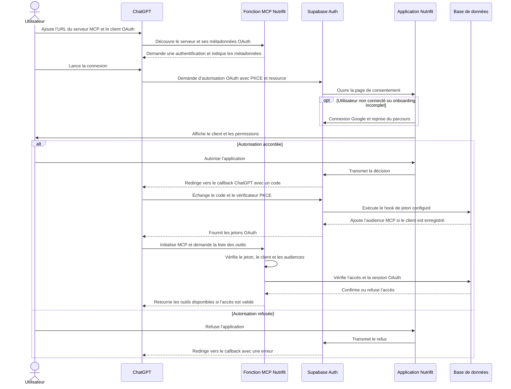

# Connecter Nutrifit à ChatGPT

L’intégration expose, après autorisation, la recherche d’aliments, la lecture d’une fiche, le bilan quotidien, un aperçu nutritionnel et la création d’un nouvel aliment privé. Elle n’écrit ni journal ni recette et ne modifie aucun aliment existant. Les outils métier restent désactivés tant que `MCP_PROBE_ONLY=true`.

## Flux d’ajout et de connexion

Avant la connexion, l’administrateur déploie la fonction MCP et configure Supabase Auth, le client OAuth public, son URL de retour exacte fournie par ChatGPT, la table `private.mcp_clients` et le hook de jeton. Le détail figure dans les sections suivantes.



En mode `MCP_PROBE_ONLY=true`, seul l’outil de vérification de connexion est publié. Avec `MCP_PROBE_ONLY=false`, les outils métier sont publiés. Une connexion OAuth réussie ne garantit pas à elle seule la découverte : le jeton et la session doivent également passer les vérifications de la fonction MCP.

## Prérequis et configuration Supabase

1. Déployer le site Angular sur HTTPS. Dans Supabase **Authentication → URL Configuration**, régler le Site URL sur l’URL de l’application, chemin GitHub Pages inclus, et ajouter l’URL exacte `/auth/callback` aux redirections autorisées. L’URL du consentement devient `<Site URL>/oauth/consent`.
2. Dans **Authentication → OAuth Server**, activer OAuth 2.1 et définir le chemin d’autorisation `/oauth/consent`. Laisser l’inscription dynamique désactivée pour cette intégration préenregistrée.
3. Configurer une clé de signature JWT asymétrique ES256 ou RS256. Le flux annonce le scope `openid`, qui requiert une clé asymétrique chez Supabase.
4. Appliquer les migrations, dans l’ordre, avec `supabase db push`. La migration `20261030100000_mcp_oauth.sql` ajoute le hook de jeton et les restrictions RLS ; elle n’enregistre ni client OAuth ni ressource active.
5. Créer le client public OAuth Nutrifit dans **Authentication → OAuth Apps**. Utiliser exclusivement l’URI de redirection HTTPS exacte affichée par la configuration de l’application MCP ChatGPT. Ne pas supposer qu’une URI de rappel stable convient à tous les modes ChatGPT.
6. Après avoir obtenu son identifiant, inscrire ce client et la ressource exacte du serveur dans la table privée :

```sql
insert into private.mcp_clients (client_id, resource, enabled)
values ('<CLIENT_ID>', 'https://<PROJECT_REF>.supabase.co/functions/v1/mcp', true);
```

Ne jamais mettre de secret de service ou de clé `service_role` dans Angular, les paramètres ChatGPT ou les secrets de la fonction. La fonction utilise la clé publique Supabase et le jeton utilisateur.

7. Dans **Authentication → Hooks**, activer **Custom Access Token Hook**, choisir le type **Postgres function**, puis sélectionner `public.mcp_access_token_hook`. Appliquer la migration crée la fonction mais ne l'active pas dans Auth. Après activation, déconnecter puis reconnecter Nutrifit dans ChatGPT afin d'obtenir un nouveau jeton.

Pour vérifier l'inscription du client dans le SQL Editor, sans afficher de jeton :

```sql
select client_id, resource, enabled
from private.mcp_clients
where client_id = '<CLIENT_ID>';
```

La ligne doit être activée et la ressource doit correspondre exactement à `MCP_RESOURCE_URL`. Le même client doit être utilisé dans `MCP_CLIENT_ID` et ChatGPT. Sans hook actif et client enregistré, un jeton Supabase standard ne contient pas l'audience MCP requise et la découverte échoue après la connexion OAuth.

## Déployer en mode connexion seule

Définir les secrets et paramètres de la fonction :

```sh
supabase secrets set \
  MCP_RESOURCE_URL=https://<PROJECT_REF>.supabase.co/functions/v1/mcp \
  MCP_CLIENT_ID=<CLIENT_ID> \
  MCP_ALLOWED_ORIGINS=https://chatgpt.com \
  MCP_PROBE_ONLY=true
supabase functions deploy mcp --no-verify-jwt
```

La désactivation de la vérification JWT du proxy est nécessaire parce que la fonction valide elle-même la signature, l’émetteur, les audiences, l’expiration, le rôle et l’identifiant OAuth. Toutes les requêtes métier repassent ensuite par RLS avec le jeton utilisateur. Le hook ajoute l’audience MCP tout en conservant `authenticated` pour l’API Supabase.

Tester la découverte à `https://<PROJECT_REF>.supabase.co/functions/v1/mcp/.well-known/oauth-protected-resource`, puis ajouter `https://<PROJECT_REF>.supabase.co/functions/v1/mcp` comme serveur MCP personnalisé dans ChatGPT, avec OAuth. Vérifier la connexion, le refus, la reprise après Google et l’onboarding, puis la révocation. ChatGPT donne parfois le chemin de découverte par une réponse `401` : cette réponse inclut le lien vers les métadonnées protégées.

**Point d’intégration à confirmer avant activation :** les documents Supabase décrivent l’échange OAuth, les clients préenregistrés, le hook de jeton et l’audience Supabase ; ils ne garantissent pas ici le traitement du paramètre `resource` envoyé par ChatGPT. Le flux complet doit être essayé contre le projet Supabase et le callback exact fournis par ChatGPT. Garder le mode connexion seule tant que l’échange de code PKCE et le jeton à double audience n’ont pas été observés.

## Activer les outils Nutrifit

Après validation du flux de découverte et de l’audience, passer `MCP_PROBE_ONLY=false`, redéployer la fonction et rafraîchir les outils dans ChatGPT. Si le client ou la ressource change, mettre à jour les secrets et `private.mcp_clients` ensemble.

Les recommandations doivent lire le bilan du jour puis rechercher dans le catalogue. Une photo ne doit pas être envoyée à Nutrifit. Avant une création, ChatGPT doit expliquer ses estimations, appeler `preview_food`, montrer la fiche normalisée et attendre l’accord explicite dans la conversation. Le serveur ne peut pas prouver indépendamment qu’une personne a donné cet accord.

Les utilisateurs peuvent voir et révoquer les autorisations dans **Profil → Applications connectées**. La révocation supprime la session OAuth ; les vérifications de session en base refusent aussi un jeton dont le client a été désactivé.

## Vérifications locales

- MCP : `cd supabase/functions/mcp && deno task check && deno task test`
- PostgreSQL isolé : `scripts/mcp/test-sql.sh` (nécessite Docker)
- Angular : depuis `nutrifit-app/`, `bun run test`, `bun run build` et `bun run lint`. Pour un build de développement sans environnement de production : `bun run ng build --configuration development`.

Le test SQL crée un PostgreSQL éphémère et un contrat Auth minimal ; il ne remplace pas un essai réel contre Supabase Auth et ChatGPT.
